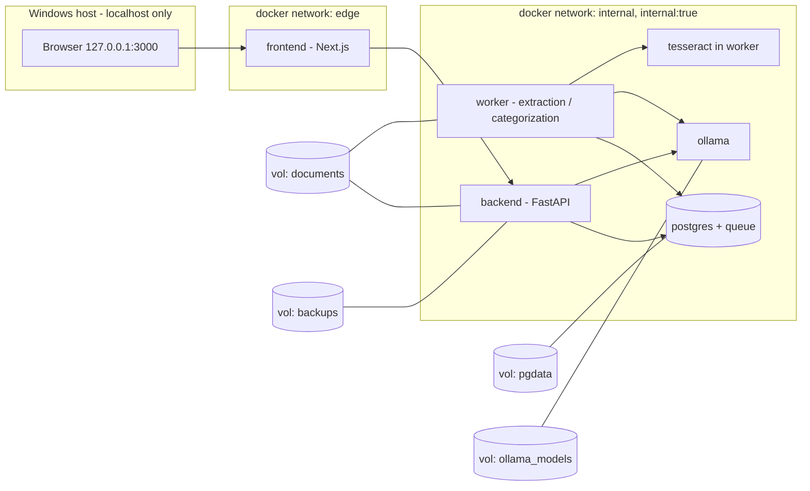

# Lanka Finance AI: Architecture & Design

Status: approved design; phases 1 to 4 and part of 5 are implemented. Section 12 lists what
is built, what differs from this design and what is still open. Where a section below
disagrees with section 12, section 12 describes the code.

## 0. Decisions recorded from the requirements Q&A

| Topic | Decision |
|---|---|
| Users | Single user. Keep a `user_id` column on user-owned tables so multi-user can be added later without a schema rewrite. |
| Data location | Docker **named volumes** only. No bind mounts of data. Project itself moves to `D:\lanka-finance-ai` (outside OneDrive). Backups go to a user-chosen path outside OneDrive. |
| Target hardware | i5-1135G7, 4C/8T, 15.7 GB RAM, no NVIDIA GPU, Windows 11 + Docker Desktop (WSL2). CPU-only is the primary target. |
| Default LLM | `qwen2.5:1.5b` (configurable via `OLLAMA_MODEL`; changed from `qwen3:4b` by the user). Larger models are opt-in. LLM is a fallback/explainer, never the primary extractor. |
| Job queue | Postgres-backed queue (no Redis container). `redis` from the spec is dropped; revisit only if throughput demands it. |
| OCR | Tesseract, **English first**. Sinhala/Tamil added later as best-effort; always gated by balance validation. |
| First banks | Commercial Bank, Sampath, HNB, BOC/People's (generic adapter first, then specific). Real sample PDFs required per bank. |
| PDF passwords | Some statements are encrypted. Password is requested per upload, held in memory only, never stored or logged. |
| Assistant | LLM selects a predefined analytics function + parameters. Python/SQL computes the numbers. No free-form SQL in v1. |
| Internet | Allowed on the dev machine for building/testing. The runtime code never calls external services. Offline behaviour verified on the second machine. |
| Transfer matching | Same amount, opposite sides, different accounts, ±3 days (configurable). Ambiguous matches go to a review queue. |

## 1. Architecture diagram



Only `frontend` publishes a port, bound to `127.0.0.1`. `backend`, `worker`, `postgres`, `ollama` have no host ports. The `internal` network is `internal: true` in the offline compose override so any outbound attempt fails loudly.

## 2. Technology decisions

- **Backend:** Python 3.12, FastAPI, SQLAlchemy 2 + Alembic (migrations), Pydantic v2.
- **Queue:** Postgres `SELECT ... FOR UPDATE SKIP LOCKED` (via `procrastinate` or a small in-house table). One worker container, concurrency configurable (default 1 to protect RAM).
- **PDF:** PyMuPDF (inspection, rendering, encryption handling), pdfplumber (tables/words with coordinates), `pytesseract` + Tesseract `eng` for scans.
- **LLM:** Ollama, called with schema-constrained `format` (JSON schema derived from Pydantic) and `think:false` for Qwen3. Response is re-validated by Pydantic. Bounded retries, then falls back to "needs review". Model pinned by digest and recorded per inference.
- **DB:** PostgreSQL 16. `NUMERIC(18,2)` for money; Python `Decimal` only. No floats.
- **Frontend:** Next.js (App Router) + TypeScript, Tailwind, a charting library bundled locally, `pdf.js` for source-page viewing. No CDN, no telemetry (`NEXT_TELEMETRY_DISABLED=1`, fonts self-hosted).
- **Auth:** Argon2id password hash, server-side sessions in Postgres, HttpOnly + SameSite=Strict cookies, CSRF token on mutations, login rate limiting.
- **Reports:** openpyxl (Excel), csv, WeasyPrint or ReportLab (PDF), all local.

## 3. Docker Compose architecture

Services: `frontend`, `backend`, `worker`, `postgres`, `ollama`. (No `redis`; OCR runs inside `worker`, a separate OCR service is not justified.)

- `docker-compose.yml`: base. Healthchecks, `restart: unless-stopped`, resource limits (see below), named volumes, `edge` + `internal` networks, `stop_grace_period` for graceful shutdown, `depends_on: condition: service_healthy`.
- `docker-compose.offline.yml`: sets `internal: true` on networks, removes build contexts (images pre-loaded from the bundle), disables any pull.
- `docker-compose.gpu.yml` (profile `gpu`): optional NVIDIA reservation, not used on this hardware.
- Containers run non-root, `read_only: true` root FS where possible, `cap_drop: [ALL]`, `no-new-privileges`.
- Suggested memory budget on 16 GB: WSL2 capped at 10 GB (`.wslconfig`): ollama 5 GB (qwen3:4b Q4 ~3 GB + context), postgres 1 GB, backend 1 GB, worker 2 GB, frontend 512 MB.
- Docker's WSL disk image must be relocated to `D:` (C: has ~32 GB free). Documented in `docs/windows-setup.md` (to be written in Phase 1).
- Env vars: `OLLAMA_BASE_URL`, `OLLAMA_MODEL`, `OLLAMA_NUM_CTX`, `OLLAMA_TEMPERATURE`, `OLLAMA_TIMEOUT_S`, `FRONTEND_BIND` (default `127.0.0.1`), `FRONTEND_PORT`, confidence thresholds, `TRANSFER_MATCH_DAYS`.

## 4. Database schema (core)

All money `NUMERIC(18,2)`. All user-owned tables carry `user_id`. Timestamps `timestamptz`.

```
users(id, username, password_hash, created_at)
sessions(id, user_id, token_hash, expires_at, ...)
audit_log(id, user_id, action, entity, entity_id, detail jsonb, at)

banks(id, code, name)
accounts(id, user_id, bank_id, account_number_enc, account_number_last4,
         account_type, currency, nickname)

documents(id, user_id, bank_id, account_id, sha256 UNIQUE per user,
          storage_path, original_filename, page_count, is_encrypted,
          period_start, period_end, opening_balance, closing_balance,
          status, extraction_method, adapter, adapter_version, created_at)
document_pages(id, document_id, page_no, kind /*text|table|scanned|mixed*/, ocr_used)

transactions(id, user_id, document_id, account_id, bank_id,
  transaction_date, value_date, original_description, normalized_description,
  reference_number, debit, credit, running_balance, currency, transaction_type,
  primary_category_id, subcategory_id, merchant_id,
  classification_confidence, classification_source /*rule|user_rule|exact|llm*/,
  classification_explanation,
  extraction_confidence, extraction_method, source_page, source_bbox jsonb,
  validation_status /*ok|balance_mismatch|needs_review*/, review_status,
  is_duplicate, duplicate_of_id, is_internal_transfer, transfer_group_id,
  is_recurring, recurring_group_id, row_hash)

categories(id, user_id, parent_id, name, kind /*income|expense|transfer*/, is_system)
merchants(id, user_id, canonical_name, aliases text[])
classification_rules(id, user_id, pattern_type, pattern, category_id, merchant_id,
                     origin /*system|user_correction*/, priority, enabled, hit_count)
classification_feedback(id, user_id, transaction_id, ai_category_id,
                        user_category_id, created_rule_id, at)
transfer_groups(id, user_id, kind /*own_account|card_payment*/, status /*auto|confirmed|rejected*/)
recurring_groups(id, user_id, merchant_id, cadence, typical_amount, next_expected)
jobs(...)  -- queue table
model_runs(id, model, digest, purpose, prompt_hash, duration_ms, valid_json, at)
settings(key, value jsonb)
```

Indexes: `(user_id, transaction_date)`, `(account_id, transaction_date)`, `row_hash` for duplicate detection, trigram index on `normalized_description` for search. Dedupe key: `(account_id, transaction_date, debit, credit, running_balance, normalized_description)`.

Account numbers are stored encrypted, with only the last 4 digits in clear for masked display.

## 5. PDF processing architecture

```
upload -> sha256 duplicate check -> encrypted? -> prompt password (memory only)
  -> Stage 1 inspect (per page: text / table / scanned / mixed)
  -> bank identification (keyword + layout fingerprints; manual override)
  -> Stage 2 deterministic adapter extraction (pdfplumber words -> columns by x-coordinates)
  -> Stage 3 OCR on scanned pages only (Tesseract eng, 300 dpi render, then same adapter)
  -> Stage 4 LLM interpretation ONLY for unknown layouts / ambiguous rows
  -> Stage 5 normalization (dates, DR/CR, amount signs, wrapped description joins)
  -> Stage 6 validation (reconciliation) -> persist with provenance
```

- Pages are rendered and processed one at a time (memory-efficient). PDFs are parsed in the worker, which has no network and a non-root user, with size and page limits and a timeout.
- Wrapped descriptions: a row without a date and without amounts is appended to the previous transaction.
- Dates: each adapter declares its format (`DD/MM/YYYY`, `DD-MMM-YY`, etc.). The generic path infers the format from the whole document (any value with a field > 12 fixes day position) and flags ambiguity instead of guessing.
- The LLM is shown only the page text (and column hints) and must return rows matching the Pydantic schema. Each returned row must have its source text span located in the page text, or it is rejected. This prevents invented rows.

## 6. Local AI integration architecture

- `ai/ollama/client.py`: async client with timeout, retry limit, and `format=<json schema>`.
- Health endpoint checks: Ollama reachable, model present, model digest, a tiny warm-up inference.
- If the model is unavailable: the UI shows a clear banner, and extraction and rule-based categorization continue. Items needing the LLM are queued as `needs_ai` and processed when it returns. There is no cloud fallback.
- Hardware diagnostics screen reads CPU, RAM, disk, GPU presence (via `nvidia-smi` if present), model status, and queue depth. It recommends a model by free RAM (<10 GB free: 1.7-3B; 10-20 GB: 4B; >=24 GB or GPU: 8B).
- Prompts live under `ai/prompts/` and are versioned. `model_runs` records every call (hash, not full financial text).

## 7. Bank adapter interface

```python
class BankAdapter(Protocol):
    code: str
    version: str
    def identify(self, doc: InspectedPdf) -> float: ...          # 0..1 confidence
    def extract_metadata(self, doc) -> StatementMetadata: ...    # account, period, opening/closing
    def detect_columns(self, page: PageLayout) -> list[Column]: ...
    def extract_rows(self, doc) -> Iterable[RawRow]: ...         # handles multi-page + wrapping
    def normalize(self, row: RawRow, meta) -> Transaction: ...
    def validate(self, txns, meta) -> ValidationReport: ...
```

An adapter registry scores every adapter with `identify`. The highest score above a threshold wins; otherwise the generic adapter runs and the user may pick a bank manually. Adapters are developed against real sample PDFs kept in an untracked, gitignored `tests/fixtures/private/` folder. Only synthetic or authorized anonymized fixtures are committed.

## 8. Financial validation strategy

Deterministic code only; the LLM never validates numbers.

1. Per row: exactly one of debit/credit is non-zero (unless the bank format says otherwise). Amounts parse as `Decimal`.
2. Running balance: `prev_balance - debit + credit == balance` for each row. Failures are flagged with the row and page.
3. Statement level: `opening + sum(credits) - sum(debits) == closing`.
4. Cross-statement: the next statement's opening balance should equal the previous closing balance. Gaps/overlaps in periods are reported.
5. Dates fall within the statement period (±1 day tolerance).
6. A statement that fails reconciliation is stored as `needs_review` and is excluded from analytics until the user resolves or accepts it, with a visible count on the dashboard.
7. Extraction confidence is computed from the checks above (not self-reported by the LLM).

Metrics tracked per bank/adapter: row precision, row recall, reconciliation pass rate. No accuracy claims without these numbers.

## 9. Security threat model (summary)

| Threat | Mitigation |
|---|---|
| Data leaves the machine | No cloud SDKs; `internal: true` networks in offline mode; telemetry off; CI check that greps for external hostnames; offline test on the second machine |
| LAN/other-host access | Frontend bound to 127.0.0.1 by default; LAN needs an explicit env flag, with a warning in docs |
| Malicious PDF | Parse in a non-root, no-network worker container, with size/page/time limits and a magic-bytes check; no JavaScript execution; pinned library versions |
| OneDrive/cloud sync of data | Named volumes and a non-OneDrive backup path; setup doc and a startup warning if the backup path is under OneDrive |
| Stolen backup | Encrypted archives (age or AES-GCM via a passphrase-derived key), integrity hash verified on restore |
| Credential attacks | Argon2id, login rate limit, session expiry, CSRF tokens |
| PDF password leakage | Memory only, never in logs/DB; redacted in error reports |
| Prompt injection via statement text | LLM output is schema-constrained and re-validated; it has no tools and no DB access; the assistant picks only from an allowlisted function set |
| Log leakage | Structured logs exclude descriptions and amounts by default; account numbers masked |
| Local malware / other OS users | Out of scope for the app; documented clearly (promt.md §16) |

## 10. Development roadmap

Revised ordering: vertical slice first, then breadth. Each phase includes tests, docs, and a Docker check.

0. **Setup (you):** move the project to `D:\lanka-finance-ai`, relocate Docker's WSL disk to D:, cap WSL RAM, gather real sample PDFs (private folder).
1. **Infrastructure + slice skeleton:** compose files, Postgres + migrations, FastAPI, Next.js, auth, Ollama health + hardware screen, PDF upload (with password flow), Postgres job queue, backup/restore scripts (moved earlier).
2. **First vertical slice (one bank, your choice from the four):** inspection, adapter, reconciliation, transaction explorer with source-page viewer.
3. **More adapters** (one at a time, each with real samples and per-bank metrics), generic adapter + LLM fallback, English OCR.
4. **Categorization + learning:** rules, merchants, user corrections to rules, LLM fallback with confidence thresholds, review queue.
5. **Intelligence:** duplicates, overlap detection, internal transfers/card payments, recurring detection, dashboard and analytics.
6. **Assistant (function-calling) + reports** (Excel/CSV/PDF).
7. **Offline bundle, hardening, performance, full test and offline verification** on the second machine. Windows `.ps1` scripts alongside `.sh`.

## 11. Open items / risks

- Sinhala/Tamil OCR accuracy will be limited. It stays best-effort behind validation.
- A 4B model on CPU is slow (a few tokens/s). Batch LLM work in the background and keep it off the critical path.
- Model licences: Qwen3 is Apache-2.0 (redistribution allowed with notice). Llama models have their own licence. Only bundle weights after checking the licence (`docs/licenses.md` to follow).
- Docker Desktop on Windows needs WSL2 and enough disk. `wsl --status` shows an Ubuntu distro with WSL 2 is present.

## 12. Implementation status

Migrations 0001 to 0007 (`backend/alembic/versions`).

| Area | State | Where it is described |
|---|---|---|
| Compose stack (postgres, ollama, backend, worker, frontend), non-root, read-only, `cap_drop`, only the frontend publishes a port | Done | `docker-compose.yml` |
| Auth: Argon2id, cookie sessions, CSRF, rate limit, change password, audit log | Done | `05-user-interface.md` |
| Upload, sha256 duplicate check, password flow, retention, Postgres job queue | Done | `02-upload-and-queue.md` |
| BOC extraction, validation, reconciliation, statement totals, duplicates across statements | Done | `03-extraction.md` |
| Dashboard, trends, tracker, drill-down, transactions explorer, CSV export | Done | `03-extraction.md`, `05-user-interface.md` |
| Categories, rules, learning from corrections, review queue, bulk edit | Done | `04-categorization.md` |
| Local AI categorisation: name-based replies, confidence tiers, hunches, examples, eval tool | Done | `04-categorization.md` |
| Ollama health and hardware screen | Done | System page |
| HNB adapter (savings statements; written from one real layout, multi-page unverified) | Done, needs real-statement checks | `03-extraction.md` |
| Commercial Bank adapter (written from one quiet-account layout; ordinary debits/credits and multi-page unverified) | Done, needs real-statement checks | `03-extraction.md` |
| Sampath Bank adapter (savings statement; written from one real layout, multi-page unverified) | Done, needs real-statement checks | `03-extraction.md` |
| Commercial, Sampath adapters; generic adapter; LLM extraction fallback; OCR | Not started | |
| Backup and restore scripts, manual categories kept on re-extract, per-bank duplicate matching | Done (scripts untested on the real install until run) | `06-backup-and-restore.md` |
| Offline compose override, GPU override, healthchecks for worker and frontend | Not started | |
| Backup and restore scripts, encrypted archives | Not started | |
| Internal transfer matching, recurring detection, merchants | Not started (`transfers` kind exists on categories only) | |
| Assistant (function calling) and reports (Excel, PDF) | Not started | |

### Where the code differs from the design above

- **Account numbers:** the full number is never stored. `accounts` keeps the last 4 digits and
  an HMAC-SHA256 fingerprint (key `ACCOUNT_FINGERPRINT_KEY`, or one generated into `settings`).
  Section 4's `account_number_enc` is not used.
- **Source-page viewer:** server-rendered PNGs (PyMuPDF), not pdf.js, and only while the
  original file is kept.
- **Adapter interface:** `identify` + `parse` only.
- **Default model:** `qwen2.5:1.5b` is the compose default, but the evaluation in
  `04-categorization.md` shows `qwen2.5:3b` is the smallest model that categorises reliably.
- **AI output:** the model returns a category *name* from a closed list (schema `enum`), not an
  id, and its confidence is not trusted on its own.
- **Transactions columns:** `category_id` and `suggested_category_id` (migration 0007) replace
  `primary_category_id` / `subcategory_id`; `classification_source` is
  `rule | user_rule | manual | llm | llm_unsure`.
- **Not created yet:** `merchants`, `transfer_groups`, `recurring_groups`.
- **Frontend dependencies:** no charting library; charts are hand-drawn SVG.
- **Env vars:** `LLM_*` settings control the AI pass (see `04-categorization.md`). The worker
  reads its Ollama timeout from `LLM_TIMEOUT_S`, the backend from `OLLAMA_TIMEOUT_S`.
  Compose forwards only the variables it lists.
